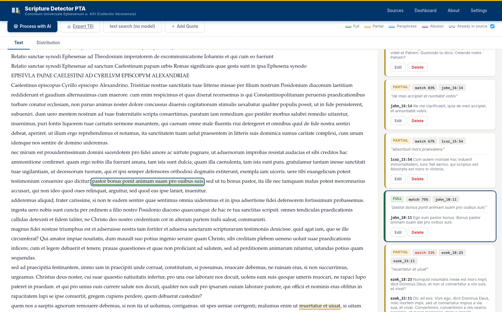
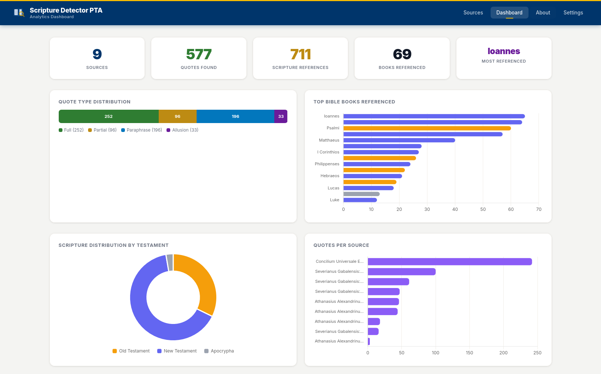
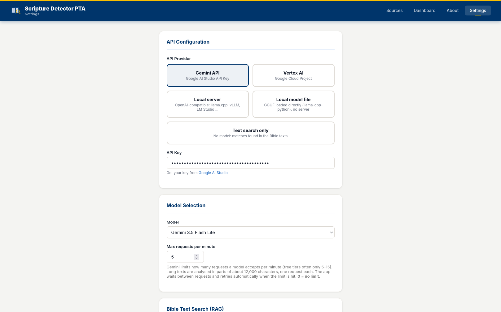
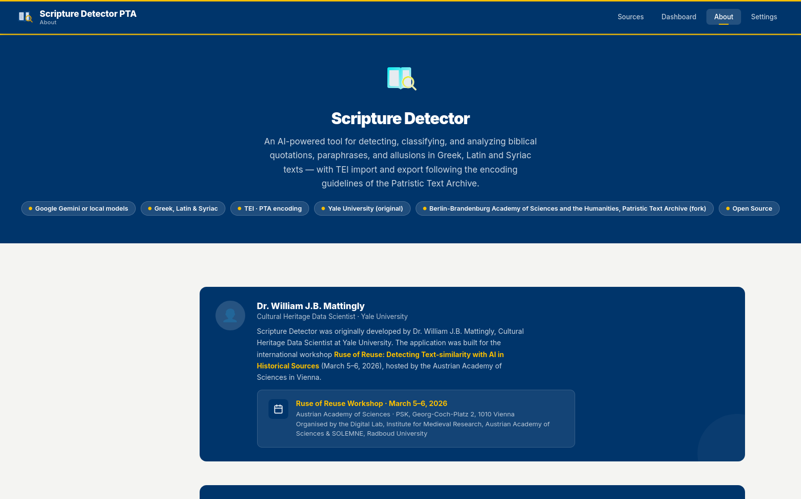

# Scripture Detector

> **AI-powered detection and analysis of biblical quotations, paraphrases, and allusions in historical texts.**


Originally developed by **Dr. William J.B. Mattingly**, Cultural Heritage Data Scientist at Yale University.

Built for the international workshop **[Ruse of Reuse: Detecting Text-similarity with AI in Historical Sources](https://www.oeaw.ac.at/en/imafo/events/event-details/ruse-of-reuse)** — held **March 5–6, 2026** at the Austrian Academy of Sciences, Vienna.

---

## This fork: Greek Bible, TEI import and PTA-style TEI export

This fork developed by **Dr. habil. Annette von Stockhausen** (Berlin-Brandenburg Academy of Sciences and the Humanities, PTA) for PTA use (coding with the help of Claude Sonnet 5.5).

This fork of [yale-ch/scripture-detector](https://github.com/yale-ch/scripture-detector) detects quotations from the **Greek Bible** (Septuagint and New Testament) as well as from the **Vulgata** and works directly on **TEI files**.

**Bible text.** `data/greek/` is generated by `scripts/build_greek_bible.py` from the Greek Bible texts of the
[Patristic Text Archive](https://github.com/PatristicTextArchive/pta_data) (`data/pta9999/*/*-grc1.xml`; 80 books, 37,034 verses,
LXX in Rahlfs' numbering, NT). These texts are licensed **CC BY-SA 4.0** (Berlin-Brandenburg Academy of Sciences and Humanities), so `data/greek/` is under the same licence; the code stays MIT. Internal book codes are the lower-cased PTA abbreviations (`gn`, `ps`, `mt`, `1cor` …). The Latin Vulgate data of the original project lives in `data/vulgate/` (with PTA abbreviations added, corpus prefix `Vg`).

```bash
git clone --depth 1 https://github.com/PatristicTextArchive/pta_data.git /tmp/pta_data
python scripts/build_greek_bible.py --pta-data /tmp/pta_data      # or: --download
```

Only the primary text form (`grc1`) of each book is loaded. Alternative forms (`grc2`: Judges B, Tobit S, Old Greek Daniel/Susanna/Bel) are not.

**Greek and Latin.** Every source belongs to one language, and verses, book codes, prompt and PTA abbreviations come from the matching corpus: `grc` -> `data/greek` (cRef prefixes `LXX` / `NA`), `lat` -> `data/vulgate` (cRef prefix `Vg`, e.g. `Vg:Gn:1:1`). For TEI files the language is the `xml:lang` of the **first `<div>` in `<text>`** (`grc` or `lat`; other languages are rejected on import with a message). Pasted text is detected from its script, or can be set with `"lang"` in `POST /api/sources`. The language is shown as a small badge in the source list, and the reference picker in the viewer uses the corpus of the source.

**Import TEI.** *Sources → Import TEI* (or `POST /api/import/tei`, or a ZIP) accepts any TEI P5 file. The running text of `<text>` is extracted: `<lb break="no"/>` joins words, other `<lb/>`/`<pb/>` become spaces, `<choice>` uses `expan`/`reg`/`corr`, `<app>` uses `<lem>`, `<note>`, `<rdg>`, `<del>` and `<div type="praefatio">` are skipped. The original XML is kept in the database. Quotations written by an earlier export are restored; biblical markup made by hand is left untouched.

**Export TEI (PTA encoding guidelines).** Results are written **into the original file** following the
[PTA guidelines](https://pta.bbaw.de/en/project/encoding-guidelines#encoding-of-biblical-and-other-quotations-and-allusions):

```xml
<quote type="marked" xml:id="sd-q12">Ἐκολλήθη ἡ ψυχή μου ὀπίσω σου<ref decls="#biblical" cRef="LXX:Ps:62:9"/></quote>
<seg type="allusion" xml:id="sd-q13">…<ref decls="#biblical" cRef="NA:Mt:5:9"/></seg>
```

* `full`/`partial` → `<quote>` (`@type` `marked`/`unmarked`, according to whether the model saw an introductory formula), `paraphrase` → `<quote type="paraphrasis">`, `allusion` → `<seg type="allusion">`.
* `cRef` is `LXX:`/`NA:`/`Vg:` + PTA book abbreviation + chapter + verses. Consecutive verses become **one** `<ref>` with a range (`phil_2:8`, `phil_2:9`, `phil_2:10` → `NA:Phil:2:8-10`), also when they come from several annotations of the same existing `<quote>`; verses that do not follow each other are joined with a dot (`LXX:Ps:62:9-10.12`); different chapters or books get separate `<ref>`s.
* Quotations crossing element boundaries (`<hi>`, `<lb/>`, `<pb/>`, paragraphs, …) are fragmented and linked with `@prev`/`@next`.
* The header receives `<refsDecl xml:id="biblical">`, the `annotationstatus` taxonomy, `<p xml:id="biblical-quotations">` and a `<change>` entry. The annotation status is declared as *partially annotated*; adjust it after review.
* Pasted plain text is exported in a minimal PTA skeleton (`<div type="edition">` with a placeholder CTS URN to replace).
* Per PTA rules `<quote>` is not used in manuscript transcriptions (`…-Ms…`); the export warns in that case.
* **Existing `<quote>` elements.** Passages already marked as `<quote>` in the file are passed to the model as hints ("check these for biblical references"). If the model finds a reference for one, **no further quote element is created**: the existing `<quote>` only receives the `<ref decls="#biblical" cRef="…" xml:id="sd-r…"/>` (as last child of the last fragment, if it is split with `@prev`/`@next`) and a `@type` (`marked`/`unmarked`/`paraphrasis`) if it has none; an existing `@type` is never changed. A detected passage is matched to an existing quote if they overlap by at least 50 % in both directions; if it only overlaps in part, it is skipped with a warning. Quotes that already carry a hand-made biblical `<ref>` are left untouched. Re-importing an exported file restores the references as annotations, and re-exporting replaces them.
* **Introductory formulas.** The prompt lists typical introductions (Greek: γέγραπται, φησί(ν), λέγει, εἶπεν, ἔφη, ἡ γραφὴ λέγει, κατὰ τὸ γεγραμμένον, ὥς φησι, βοᾷ, διδάσκει, παραινεῖ, ψάλλει, ψαλμῳδεῖ, μαρτυρεῖ, κηρύττει, ἀναφωνεῖ, διαμαρτύρεται; Latin: scriptum est, dicit scriptura, ait, inquit, psallit …). They are signals for a nearby quotation and for `marked`; the formula itself is not part of the quoted text. The lists, the corpus description and further hints are in `data/<corpus>/meta.json` and can be edited.
* Elements written by the tool carry `xml:id="sd-…"`; re-exporting replaces them instead of duplicating them. If a quotation is already annotated by hand, the new one is skipped (with a warning).

**Other changes.** Accent-, breathing-, case- and sigma-insensitive matching of quotes in the text; references the model invents are checked against the Bible data and dropped; every quote gets a *match* score (share of quoted words found in the referenced verses); long texts are analysed in chunks (`SD_CHUNK_CHARS`, default 12000); the prompt is Greek-specific. Tests: `pytest tests`.

**Finding quotations with the Bible texts (RAG).** The model does not have to guess references from memory: before each request the text part is compared with *all* verses of the corpus (`retrieval.py`). The comparison is lexical and ignores accents, breathings, case, sigma and Latin u/v, i/j; words are cut to five-letter stems, so inflected forms match. Rare stems and word pairs are looked up in an inverted index (built on first use, a few seconds and about 100 MB per corpus), a sliding window over the text collects candidate verses, and an alignment of each candidate with the text ranks them.

* **Candidates in the prompt** (*Settings → Bible Text Search*, default on): the best verses, each with the passage of the text it matches, are listed in the prompt (25 for local models, 50 for Gemini, within a character budget). The model checks them instead of recalling references - this helps small local models most.
* **Repair and addition** (default on): a reference the model got wrong (low *match* score, and the passage matches another verse) is replaced by the verse the passage actually matches. Passages that clearly reuse a verse (six or more matching words, sufficient weight, not a formula that occurs in more than five verses) are added even if the model did not report them; consecutive verses become one annotation. The model's own judgement (type, `marked`) is kept; for added passages `marked` is set if one of the introductory formulas stands just before.
* **Text search only** (*Settings → AI provider*): no model at all. Full and partial quotations of about six words or more are found by the comparison alone; paraphrases and allusions need a model.

*Measured* with `python scripts/eval_retrieval.py <TEI files>` on 18 PTA editions with 2,601 hand-annotated biblical quotations (1.28 million characters): the verse given by the editors is among the 20 candidates of a text part (3,500 characters) for 82.5 % of the quotations (71 % of those with 3-5 words, 88 % with 6-10, 94 % with 11 or more words; 86.5 % with 50 candidates). Very short quotations cannot be told apart lexically. The alignment alone finds 28 % of the annotated quotations (the shorter ones are out of reach) and reports further passages: in a manual sample of 26 of them, 24 were genuine reuse that the editors had not marked up and 2 were formulas (these are now filtered); the "confirmed by gold" figure of the script (40 %) is therefore only a lower bound of the precision. This is not a measurement of any model. Please check how a given model behaves on your own texts.

**Local models (no Ollama needed).** In *Settings* choose, instead of Gemini/Vertex:

* **Local server** - any OpenAI-compatible endpoint (`/v1/chat/completions`): llama.cpp's `llama-server` (`llama-server -m Qwen3-14B-Q4_K_M.gguf --port 8080 -c 16384` → `http://127.0.0.1:8080/v1`), vLLM (`vllm serve Qwen/Qwen3-14B` → `http://127.0.0.1:8000/v1`), LM Studio (`http://127.0.0.1:1234/v1`), SGLang, LocalAI … The model name is required by vLLM/LM Studio and optional for `llama-server`. The server is asked to follow a JSON schema; if it refuses `response_format`, the app continues without (and remembers that).
* **Local model file** - a GGUF file (Qwen, Gemma, Llama, Mistral …) loaded in-process with `llama-cpp-python`, no server: `pip install "scripture-detector[local]"` or `pip install llama-cpp-python` (GPU: `CMAKE_ARGS="-DGGML_CUDA=on" pip install llama-cpp-python`, Metal: `-DGGML_METAL=on`). Set the file path, context size (`n_ctx`, default 16384 - the prompt with the candidate verses of the Bible text search plus the answer needs room; lower it if memory is short) and the number of GPU layers.

*Save & test connection* sends a tiny request with the saved settings. Notes: local models get a smaller default part size (about 3,500 characters, `SD_LOCAL_CHUNK_CHARS` or *Settings → Text Parts*) because of their context window; there is no request rate limit; the model's answer is parsed tolerantly (markdown fences, `<think>` blocks and truncated JSON are handled), and if an answer is cut off at the token limit, the text part is split in two (with a small overlap) and both halves are analysed. The model picker in the viewer is replaced by the name of the local model. Smaller models miss passages and invent references; invented verses are removed by the verse check, and the *match* score helps to spot doubtful ones. Please test a new model on a text you know before trusting its results.

**Context window of local models.** A request consists of the instructions and the book list (about 1,300 tokens), the candidate verses and the text part. For polytonic Greek this is roughly 4,500-6,000 tokens (Greek needs many tokens per word), plus the answer. Problems usually come from a context window that is smaller than expected: **many `llama-server` versions divide the context given with `-c` among their parallel slots (`-np`)**, so `-c 16384` with four slots leaves only 4,096 tokens per request. Start it with `-np 1` (e.g. `-c 16384 -np 1`). The app helps in three ways: *Save & test connection* reads the context per request from the server (`GET /props`, llama.cpp) and warns if it is below 8,192; the answer limit is capped to a third of that context; and if a request still does not fit (llama.cpp, vLLM and LM Studio error messages are recognised), the app first shortens the candidate list, then splits the text in halves, and only reports an error (naming `-np 1` / `-c`) if even a short request does not fit. The log lines of `llama-server` about the *prompt cache* ("selected slot by LCP similarity", "making room for prompt cache entry") are informational and do not indicate an error.

**Rate limits.** (Gemini / Vertex only.) Long texts are analysed in parts of about 12,000 characters (`SD_CHUNK_CHARS`), one Gemini request each. To stay within the per-minute quota of your model, requests are spaced by *Settings → Max requests per minute* (default 5, `SD_MAX_RPM` as fallback, 0 = unlimited). When the API still answers 429/503, the app waits for the delay the API suggests ("retry in 53s") or backs off exponentially (up to 6 attempts) and retries. A used-up *daily* quota is reported as such and not retried. If the limit does not clear, the parts that were already analysed are kept in memory: the next run continues with the remaining parts instead of repeating requests, and nothing is written to the database before the run is complete. The error message says how many parts were done. A deliberate re-run after a successful run asks the model again. The code is in `gemini_limits.py`.

**Notifications.** Messages are shown by `static/ui.js`: toasts stack, wrap, stay longer the longer they are (warnings and errors 1.6x), pause under the pointer and can be dismissed. Warnings of the TEI export and failed imports are additionally listed completely in a dialog that stays open until closed (with *Copy all*); identical messages are merged (`… (×3)`). Each export warning names the reason first, then the passage with context and its location: `…before «passage» after… [char 486, section 3.12, <p> 2, page 14v, line 9, xml:id "par7"]` (section = `div/@n` path, page/line = nearest preceding `pb/@n` / `lb/@n`). `GET /api/sources/<id>/export/tei?json=1` returns `{filename, xml, warnings}`.

**Known limits.** Detection quality depends on the Gemini model; the match score is a plausibility hint, not proof. Verses with letters (`2a`) are exported as the plain verse number, titles/prologues (Odes, Sirach `p`/`t`) cannot be expressed in PTA `cRef` and are skipped. Quotations spanning several *whole* paragraphs are only marked at their boundaries (with a warning).

---

## Overview

Scripture Detector is a local web application that uses Google Gemini to automatically find, classify, and annotate every biblical reference in any text you provide — from full verbatim quotations to subtle allusions. It renders an interactive, color-coded view of the source text with side-by-side Bible verse lookup, distribution charts, and a manual annotation editor.

**The only external dependency is a free Gemini API key** from [Google AI Studio](https://aistudio.google.com/apikey). No cloud account, credit card, or additional infrastructure is required.

---

## Screenshots

### Sources Page — with Advanced Search
Manage all your text sources. Use the search bar to search source content in real time, or open the **Advanced** panel to stack filters by Bible book, chapter, or verse with AND / OR logic. Match evidence appears directly on each result card.


### Text Viewer
Color-coded annotations appear directly in the text. Click any highlighted passage to see the matched Bible verse(s) in the panel on the right.



### Analytics Dashboard
Explore scripture distribution across all sources — broken down by Bible book, testament, and quote type.



### Settings
Configure your Gemini API key or Google Vertex AI credentials, and select which Gemini model to use.



### About Page
Full documentation of the application, its features, and how it works.



---

## Features

- **Full-document AI analysis** — send any text to Gemini and receive a structured list of every scripture reference with verse citations and classification types.
- **Four classification types**: Full, Partial, Paraphrase, and Allusion.
- **Color-coded in-text highlighting** — each type is rendered in a distinct color directly within the source text.
- **Click-to-explore interactivity** — click a highlighted passage to highlight the corresponding annotation card, and vice versa.
- **Selection-based re-analysis** — highlight any portion of the text to re-run AI detection on just that selection.
- **Manual annotation editor** with an integrated Bible verse picker (book → chapter → verse).
- **Advanced search** — real-time multi-filter search across all sources by text content, Bible book, chapter, or verse; filters stack with AND / OR logic and matched evidence appears inline on each result card.
- **Distribution charts** per source and across all sources (by Bible book, testament, and type).
- **Global analytics dashboard** aggregating data across all sources.
- **Model switching** — choose between available Gemini model versions in the UI.
- **Runs entirely locally** — your texts are never transmitted anywhere except for the Gemini API call itself.

---

## Advanced Search

The Sources page includes a real-time multi-filter search system:

| Filter Type | What it matches |
|---|---|
| **Text Content** | Any source whose full text contains the search string |
| **Bible Book** | Any source with at least one reference to the chosen book |
| **Chapter** | Any source with a reference to the chosen chapter (e.g. Psalms 23) |
| **Verse** | Any source with a reference to the exact chosen verse (e.g. John 3:16) |

Filters can be stacked in any combination. The **AND** mode requires a source to satisfy *every* filter; **OR** mode returns sources satisfying *any* filter. Results update within ~350 ms of each keystroke or dropdown change. Matched text snippets and verse citations appear as inline evidence on each result card.

---

## Quick Start

### 1. Prerequisites

- Python 3.10+
- [uv](https://docs.astral.sh/uv/) (recommended) or pip
- A free **Gemini API key** from [Google AI Studio](https://aistudio.google.com/apikey)

### 2. Install & Run

```bash
git clone <repo-url>
cd scripture-detector

# Using uv (recommended)
uv run python app.py

# Or using pip
pip install -e .
python app.py
```

The app starts at **http://127.0.0.1:5001**.

### 3. Configure API Key

1. Open [http://127.0.0.1:5001/settings](http://127.0.0.1:5001/settings)
2. Select **Gemini API** as the provider
3. Paste your API key from [Google AI Studio](https://aistudio.google.com/apikey)
4. Click **Save Settings**

### 4. Analyze a Text

1. Go to the **Sources** page and click **Add Source**
2. Give your source a name and paste in the text to analyze
3. Click **View** to open the text viewer
4. Click **Process with AI** — Gemini will detect all scripture references within seconds
5. Click any highlighted passage to explore the matched Bible verses

---

## Quote Classification

| Type | Description |
|---|---|
| **Full** | A complete or near-complete verse quoted verbatim |
| **Partial** | A recognizable portion of a verse with minor variation or truncation |
| **Paraphrase** | Biblical content restated in different words, preserving the meaning |
| **Allusion** | A brief phrase, thematic echo, or indirect reference to a specific verse |

---

## Project Structure

```
scripture-detector/
├── app.py              # Flask application and API routes
├── database.py         # SQLite database layer
├── corpora.py          # Bible corpora per language (grc / lat), language detection
├── greek.py            # accent-insensitive span search, scoring, PTA cRef conversion
├── tei_doc.py          # TEI reading and PTA-style export
├── main.py             # CLI batch evaluation script (Latin/Vulgate)
├── scripts/build_greek_bible.py   # builds data/greek from the PTA repository
├── tests/              # pytest
├── data/
│   ├── greek/          # bible.tsv, book_mapping.tsv, meta.json (default)
│   └── vulgate/        # Latin Vulgate data (lat)
├── templates/
│   ├── sources.html    # Sources listing page
│   ├── viewer.html     # Annotated text viewer
│   ├── dashboard.html  # Global analytics dashboard
│   ├── settings.html   # API configuration
│   └── about.html      # About / documentation page
└── static/
    ├── style.css        # Yale color palette stylesheet
    ├── logo.svg         # Application logo
    └── favicon.svg      # Browser tab icon
```

---

## API Providers

### Gemini API (Free Tier)
The simplest option. Get a free key at [Google AI Studio](https://aistudio.google.com/apikey) — no billing required. Select **Gemini API** in Settings and paste your key.

### Google Vertex AI
For enterprise use or higher rate limits. Requires a Google Cloud project with Vertex AI enabled. Select **Vertex AI** in Settings and enter your project ID and location.

---

## About

**Original Developer:** Dr. William J.B. Mattingly  
**Affiliation:** Yale University, Cultural Heritage Data Scientist  
**Workshop:** [Ruse of Reuse: Detecting Text-similarity with AI in Historical Sources](https://www.oeaw.ac.at/en/imafo/events/event-details/ruse-of-reuse)  
**Workshop Dates:** March 5–6, 2026  
**Workshop Venue:** Austrian Academy of Sciences, PSK Georg-Coch-Platz 2, 1010 Vienna  
**Organisers:** Digital Lab, Institute for Medieval Research, Austrian Academy of Sciences & [SOLEMNE](https://canones.org/), Radboud University  

---

## License

MIT
